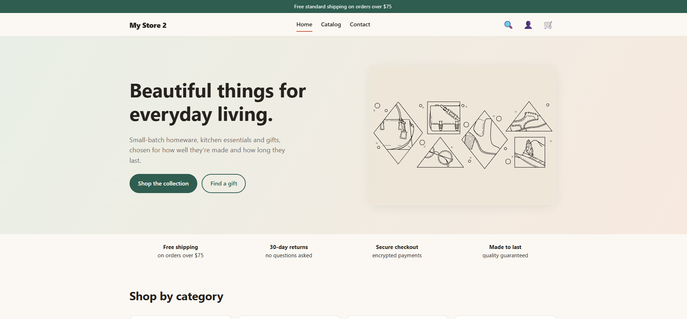

# Lumen & Loom — Custom Shopify Online Store 2.0 Theme

A custom-built, responsive e-commerce storefront theme engineered from scratch using Shopify's **Online Store 2.0** architecture (Liquid, JSON templates, modular sections, and vanilla JavaScript/CSS). Designed to provide merchants with full drag-and-drop customization in the Shopify Theme Editor without relying on heavy third-party frameworks. Practice theme build; code is shared for portfolio review while the storefront itself is not published live.

## Live Preview & Screenshots


## Technical Architecture & Features
* **Online Store 2.0 Modularity:** Built with 16 reusable Liquid sections (`sections/`) and 8 JSON templates (`templates/`), allowing non-technical merchants to rearrange page layouts dynamically.
* **Asynchronous Cart & Live Variant Logic (`assets/theme.js`):** Implemented Ajax-powered add-to-cart functionality, dynamic variant selection with real-time price/inventory updates, and a live free-shipping threshold progress bar.
* **Storefront Filtering & Search:** Integrated native Shopify Search & Discovery filtering (availability, price ranges), sorting, and predictive search templates.
* **Technical SEO & Structured Data (`snippets/meta-tags.liquid`):** Engineered built-in JSON-LD Product structured data, canonical URL handling, and dynamic Open Graph/Twitter meta tags.
* **Graceful Fallbacks:** Designed collection tiles and featured grids to degrade gracefully if store collections are unconfigured.

## Repository Structure
* `theme/` — Core Shopify theme files (`layout/`, `templates/`, `sections/`, `snippets/`, `assets/`, `config/`, `locales/`).
* `sample-products.csv` — 12 formatted demo products for rapid store seeding.

## Local Development & Installation
### Shopify CLI
```bash
cd theme
shopify theme dev --store your-store.myshopify.com
